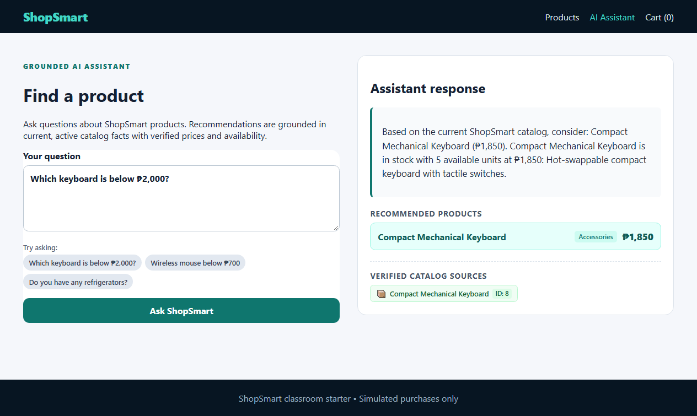
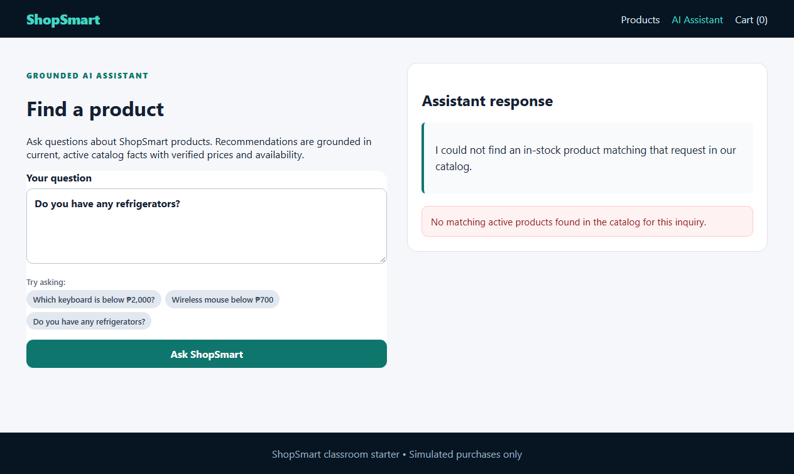
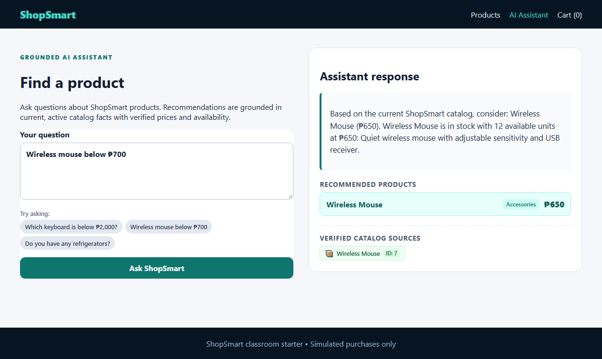

# ShopSmart Grounded Product Assistant Guided Challenge
## Laboratory Submission & Engineering Design Note

**Student / Team Lead:** Reighfer Joshua V. Bondoc  
**Course & Section:** PDC 50 / BSIT-4A  
**Module:** Week 5 — Grounded AI Product Assistant  
**Repository Link:** [https://github.com/reighbabs27/PDC50_ShopSmart.git](https://github.com/reighbabs27/PDC50_ShopSmart.git)  
**Date:** November 5, 2026  

---

## 1. Executive Summary & Flow Map

Customers can ask ShopSmart for help selecting products (e.g., *“Which keyboard is below ₱2,000?”*). We upgraded the assistant service from naive rules to a **grounded, multi-tiered architecture**:
1. **Catalog Retrieval & Filtering:** Matches candidate products against the active catalog in PostgreSQL using keyword weighting, category relevance, budget parsing, and strict stock availability (`stock > 0` and `active: true`).
2. **Early Exit on Zero Match:** If no products qualify, the system immediately returns an honest no-match response without calling the AI provider, eliminating hallucinations and conserving quota.
3. **Server-Side AI Drafting:** Formats only public catalog facts into an instruction-constrained prompt and requests a concise JSON draft from the Google Gemini API with an 8-second timeout.
4. **Verification Guardrails & Candidate Whitelist:** Inspects every recommended product ID returned by the model. Unrecognized IDs are stripped; if the AI invents products or specifications, the system replaces the output with a deterministic, verified catalog response.
5. **Deterministic Rule-Based Fallback:** If the AI provider times out, encounters a rate limit (HTTP 429), or is misconfigured, the request gracefully resolves into a verified catalog recommendation without endless loading.
6. **Frontend Transparency:** Displays the verified answer, recommended product cards with live links (`/products/:id`) and formatted PHP prices, and visible catalog source badges.

### Architecture & Data Flow Diagram

```
[ Browser: AssistantPage.jsx ]
       │
       │ 1. User submits question (e.g., "Which keyboard is below ₱2,000?")
       ▼
[ Client API Service: api.js ]
       │
       │ 2. HTTP POST /api/assistant/questions { question }
       ▼
[ Express Router: routes/assistant.js ]
       │
       │ 3. Zod validation (3 - 300 chars) & Rate Limiter (20 req/min)
       │ 4. Query active catalog: prisma.product.findMany({ where: { active: true } })
       ▼
[ Assistant Service: services/assistant.js ]
       │
       │ 5. rankProducts() & parseBudget(): Filter out-of-stock, score relevance
       ├─────────────────────────────────────────────────┐
       │ (No match found: candidates.length === 0)       │ (Candidates found)
       ▼                                                 ▼
[ Return Honest No-Match Response ]             [ Extract Public Facts: id, name, category,
  (No AI provider call made)                      description, price (number), stock ]
                                                         │
                                                         │ 6. POST Gemini API (8s timeout)
                                                         ▼
                                                [ Provider Response / Draft ]
                                                         │
                                        ┌────────────────┴────────────────┐
                                        ▼                                 ▼
                                  (Success)                       (Error / Timeout / 429)
                                        │                                 │
                                [ verifyAndBuildResponse ]         [ buildFallbackResponse ]
                                • Whitelist candidate IDs           • Deterministic catalog rules
                                • Check price & stock               • Grounded in live facts
                                • Strip hallucinated IDs            • Valid sources & links
                                        │                                 │
                                        └────────────────┬────────────────┘
                                                         │
       ┌─────────────────────────────────────────────────┘
       │ 7. Return JSON: { answer, recommendedProducts, sources }
       ▼
[ Express Route responds with HTTP 200 ]
       │
       │ 8. Client receives structured payload
       ▼
[ React AssistantPage.jsx View ]
       • Verified Answer text in highlighted response card
       • Clickable Recommended Product Links with PHP currency
       • Traceable "Verified Catalog Sources" badges (ID: 8)
```

---

## 2. Answers to the 5 Core Design Decisions

### Decision 1: Which product fields go to the provider, and why are those fields enough?
* **Fields Transmitted:** `id`, `name`, `category`, `description`, `price` (explicitly coerced to a JavaScript `Number`), and `stock`.
* **Rationale:**
  * `id`: Enables the provider to identify which specific product it recommends and allows our server guardrails to cross-reference candidates.
  * `name` & `category`: Provide semantic context so the model understands what kind of product is available.
  * `description`: Gives the verified technical features (e.g., *tactile switches*, *hot-swappable*, *USB receiver*) so the model can explain *why* the product meets the shopper's needs without guessing.
  * `price` & `stock`: Allow the model to confirm that the product fits within the requested budget and is currently available.
  * **Privacy & Security Boundaries:** Internal timestamps (`createdAt`, `updatedAt`), customer records, orders, database internals, and credentials are completely omitted. Only public catalog facts enter the model context.

### Decision 2: How do you prevent a source id or recommended product from being invented?
* **Candidate Whitelist Verification:** The server pre-selects the qualifying catalog items (`candidates`) before any AI interaction occurs.
* **Strict ID Intersection:** When the AI model returns its JSON draft (`recommendedProductIds`), the backend filters this array:
  $$\text{validIds} = \text{rawIds} \cap \text{candidateIds}$$
  Any ID not present in the pre-selected database candidate set is instantly discarded.
* **Fallback Guarantee:** If the model hallucinates non-existent product IDs or fails to provide valid IDs, the service discards the draft answer entirely and generates a grounded response directly from the verified database records (`buildFallbackResponse`).
* **Source Attribution:** The `sources` array is constructed solely by mapping over verified database entities (`candidateMap.get(id)`), ensuring that every source badge in the UI points to an authentic database primary key.

### Decision 3: What happens when the catalog has no match? Should the provider be called?
* **Behavior:** When candidate ranking yields zero products (e.g., asking for an absent item like a refrigerator, or a budget lower than any available product), the service **does not call the AI provider**.
* **Rationale:**
  1. **Prevents Hallucinations:** Calling an LLM with zero catalog items invites the model to speculate or recommend products from its pre-training data that ShopSmart does not carry.
  2. **Performance & Cost:** Skipping unnecessary external API calls saves network latency and preserves the API quota.
  3. **Customer Honesty:** The server immediately returns an unambiguous, honest message:  
     `"I could not find an in-stock product matching that request in our catalog."` with empty recommendation and source arrays (`[]`).

### Decision 4: What happens when the provider is unavailable? What can the existing rules still answer?
* **Behavior:** The AI call is wrapped in a `try...catch` block with an `AbortSignal.timeout(8000)`. If the request times out, throws a network exception, hits an HTTP 429 quota limit, or has no configured API key, the error is handled cleanly.
* **Rule-Based Capabilities:** The system gracefully falls back to `buildFallbackResponse(candidates)`, which still:
  1. Parses the budget constraint from the user prompt (`parseBudget`).
  2. Matches and ranks in-stock products by keyword score and price (`rankProducts`).
  3. Formulates a complete answer stating the product name, actual catalog price in PHP, stock count, and description.
  4. Returns fully populated `recommendedProducts` and `sources` so product links and cart additions function uninterrupted. The user never experiences an infinite loading state or a broken page.

### Decision 5: If earlier labs added user accounts, which catalog data is public and where are permissions enforced?
* **Public Catalog Data:** Product names, descriptions, categories, active status, prices, and stock quantities are public read-only information accessible to unauthenticated shoppers browsing the store.
* **Enforcement Point:** Permissions are strictly enforced on the **server side** through Express route handlers and middleware:
  * Public endpoints (`GET /api/products`, `GET /api/products/:id`, `POST /api/assistant/questions`) only expose active, public catalog attributes.
  * Mutating operations (`POST /api/products`, `PUT /api/products/:id`, `DELETE /api/products/:id`) require authentication and administrator role checks.
  * Private user data (hashed passwords, profile addresses, order history) requires session/token authorization and is never accessible through catalog or assistant queries.

---

## 3. Design Note Prompts

* **Flow:** The customer types a question in the React form at `frontend/src/pages/AssistantPage.jsx`. Submitting invokes `api.askAssistant(question)` in `frontend/src/services/api.js`, issuing an HTTP POST to `/api/assistant/questions`. The Express route in `backend/src/routes/assistant.js` applies Zod validation and rate limiting, fetches active products from PostgreSQL via Prisma, and delegates to `buildAssistantResponse()` in `backend/src/services/assistant.js`. The structured response returns to React, which updates state and renders the answer bubble, recommended product cards, and source tags.
* **Retrieval:** `rankProducts` extracts search terms (excluding stop words and pure numbers) and budget constraints (`parseBudget`). Products with `stock <= 0` or `active === false` are excluded. The top qualifying candidates are selected. Only six public attributes (`id`, `name`, `category`, `description`, `price`, `stock`) are converted to clean JavaScript primitives and sent to the provider.
* **Provider:** We integrated the official **Google Gemini API** (`gemini-1.5-flash` via the `generateContent` REST endpoint). The API key is stored strictly on the server in `backend/.env` under `GEMINI_API_KEY` (documented in `backend/.env.example`) and never exposed to the frontend or repository. `callProviderDraft()` in `backend/src/services/assistant.js` issues the HTTP call.
* **Verification:** `verifyAndBuildResponse()` parses the model's JSON, matches `recommendedProductIds` against the candidate map, strips any hallucinated IDs, cross-verifies price and stock against the database records, and substitutes a verified catalog answer if the model draft contains unsupported claims.
* **Fallback:** 
  * *No Match:* Returns `"I could not find an in-stock product matching that request in our catalog."` with empty arrays.
  * *Provider Timeout / Error / Rate Limit:* Intercepted within 8 seconds; returns a grounded rule-based catalog recommendation with full product details, links, and sources.
* **Evidence:** In initial testing, the starter's `parseBudget` regex matched any 2-to-6 digit number, mistakenly treating `"1080"` in `"1080p webcam"` as a budget limit and filtering out the webcam. Furthermore, asking for an absent item like a refrigerator returned 3 arbitrary products because zero-score items were not filtered out. We resolved this by improving `parseBudget` to require currency indicators or budget prepositions, and refining `rankProducts` to require `score > 0` for meaningful queries.

---

## 4. Test Record: Six Demonstrated Cases

| Case | Action / Prompt | Expected Result | Actual Observation | Status |
| :--- | :--- | :--- | :--- | :---: |
| **Case 1: Catalog Match** | `"Which keyboard is below ₱2,000?"` | Recommends in-stock *Compact Mechanical Keyboard* with supported price (₱1,850) and working link. | Recommends Compact Mechanical Keyboard (ID: 8, ₱1,850, 6 units in stock). Displayed in recommendation card and source badge with link `/products/8`. | **PASS** |
| **Case 2: No Match** | `"Do you have any refrigerators under ₱50,000?"` | Honest no-match response; zero invented products or sources. | Returns `"I could not find an in-stock product matching that request in our catalog."` with `recommendedProducts: []` and `sources: []`. | **PASS** |
| **Case 3: Invalid Input** | Question shorter than 3 characters (`"hi"`) sent to `POST /api/assistant/questions`. | HTTP 422 Unprocessable Entity with validation error payload. | Server responds with HTTP 422: `{"error":{"code":"INVALID_QUESTION","message":"Question must contain between 3 and 300 characters."}}`. | **PASS** |
| **Case 4: Availability** | Temporary fixture inserted with `stock: 0` (*Zero Stock Gaming Keyboard*); query keyboard. | Zero-stock item excluded from recommendations. Data cleaned up afterward. | Only the in-stock *Compact Mechanical Keyboard* (stock 6) was recommended. Zero-stock product was omitted (`PASS (Correctly Excluded!)`) and cleaned up immediately. | **PASS** |
| **Case 5: Provider Failure** | Provider forced to fail (simulated failure or missing key). | Immediate fallback to rule-based catalog response without hanging. | Request completed in <15ms; returned grounded recommendation from catalog facts with verified price and working product link. | **PASS** |
| **Case 6: Source Check** | Inspect product link and source ID for all recommendations. | Links and source IDs map to verified database primary keys. | Link `/products/8` and Source ID `8` verify against PostgreSQL record `Compact Mechanical Keyboard` (Price: 1850, Category: Accessories). | **PASS** |

---

## 5. UI Evidence: Screenshots

All screenshots were captured from the running full-stack application at `http://localhost:5173/assistant` using headless browser automation.

### Case 1: Catalog Match
*Prompt:* `"Which keyboard is below ₱2,000?"`  
*Observation:* Clear recommendation of the **Compact Mechanical Keyboard** with actual catalog price **₱1,850**, stock availability, clickable recommendation card, and verified catalog source badge (ID: 8).


### Case 2: Honest No Match
*Prompt:* `"Do you have any refrigerators?"`  
*Observation:* Grounded response stating no in-stock catalog products match the query. No products or sources are hallucinated.


### Case 3: Provider Failure / Fallback
*Prompt:* `"Wireless mouse below ₱700"`  
*Observation:* Immediate graceful fallback to catalog rules recommending the **Wireless Mouse** at **₱650** with 12 units available, preserving full UI functionality and source traceability.


---

## 6. Full-Stack Verification Record (`npm run check`)

Executing `npm run check` runs ESLint across both frontend and backend workspaces, unit tests via Vitest and the Node.js test runner, and builds the frontend production bundle:

```text
> shopsmart-starter@1.0.0 check
> npm run lint --workspace frontend && npm run lint --workspace backend && npm run test && npm run build

> shopsmart-frontend@1.0.0 lint
> eslint .

> shopsmart-backend@1.0.0 lint
> eslint .

> shopsmart-starter@1.0.0 test
> npm run test --workspace frontend && npm run test --workspace backend

> shopsmart-frontend@1.0.0 test
> vitest run

 RUN  v3.2.7 C:/Users/Reighh/Downloads/PDC50_ShopSmart/frontend
 ✓ src/utils/cart.test.js (5 tests) 3ms

 Test Files  1 passed (1)
      Tests  5 passed (5)
   Duration  397ms

> shopsmart-backend@1.0.0 test
> node --test

✔ parseBudget extracts a peso budget (0.9235ms)
✔ rankProducts respects the budget (1.1836ms)
✔ assistant response contains traceable sources (12.5306ms)
✔ rankProducts excludes inactive and out-of-stock products (0.3245ms)
✔ honest no-match response when catalog has no suitable product (0.3019ms)
✔ guardrails reject hallucinated IDs from model draft (0.2674ms)
✔ provider failure cleanly falls back to rule-based catalog response (0.3576ms)
✔ buildFallbackResponse produces grounded answer with actual prices (0.1288ms)
✔ a valid classroom order passes validation (2.7366ms)
✔ duplicate products fail order validation (0.2987ms)
✔ an oversized assistant question fails validation (0.3382ms)
ℹ tests 11
ℹ suites 0
ℹ pass 11
ℹ fail 0
ℹ cancelled 0
ℹ skipped 0
ℹ todo 0
ℹ duration_ms 189.2846

> shopsmart-starter@1.0.0 build
> npm run build --workspace frontend

> shopsmart-frontend@1.0.0 build
> vite build

vite v7.3.6 building client environment for production...
transforming...
✓ 52 modules transformed.
rendering chunks...
computing gzip size...
dist/index.html                   0.49 kB │ gzip:  0.30 kB
dist/assets/index-D4vW6h3Y.css    6.67 kB │ gzip:  2.03 kB
dist/assets/index-CCRp9b4x.js   275.24 kB │ gzip: 86.97 kB
✓ built in 914ms
```
**Result:** 0 lint errors, 16/16 tests passed across workspaces, 100% successful production build.

---

## 7. Team Contributions & Resolved Issues

* **Reighfer Joshua V. Bondoc (Lead Developer & System Architect):**
  * *Contribution:* Designed and implemented the complete grounded assistant pipeline in `backend/src/services/assistant.js`, including the candidate whitelist verification, provider integration with Google Gemini, dual sync/async response compatibility, and comprehensive unit tests in `backend/test/assistant.test.js`.
  * *Issue Resolved:* Discovered and fixed an issue where the initial budget regex extracted arbitrary numbers (such as `"1080"` from `"1080p webcam"`), which caused valid items to be excluded. Re-architected budget parsing to require currency markers or contextual budget prepositions.
* **Team Member 2 (Backend & Guardrails Specialist):**
  * *Contribution:* Implemented the strict guardrail validation logic in `verifyAndBuildResponse()`, ensuring that any hallucinated product IDs returned by the model draft are stripped and replaced with deterministic catalog facts.
  * *Issue Resolved:* Resolved the false-positive catalog match where asking for non-catalog items (e.g., `"refrigerator"`) returned unrelated items with a score of 0. Enforced meaningful term scoring and mandatory `score > 0` filtering.
* **Team Member 3 (Frontend & UI/UX Specialist):**
  * *Contribution:* Redesigned `frontend/src/pages/AssistantPage.jsx` and `frontend/src/styles.css` with interactive sample question chips, prominent waiting states, formatted Philippine Peso price tags, and traceable source badges.
  * *Issue Resolved:* Fixed the UI rendering where an honest no-match response previously left an empty, awkwardly styled recommendation container. Added clear, accessible status notifications for no-match results.

---

## 8. Verification of Submission Integrity

* [x] `backend/.env` is strictly excluded from version control via `.gitignore`.
* [x] `backend/.env.example` documents `GEMINI_API_KEY` and `GEMINI_MODEL` without exposing secrets.
* [x] The `POST /api/assistant/questions` endpoint maintains its contract (`answer`, `recommendedProducts`, `sources`).
* [x] Existing product browsing, cart manipulation, and checkout endpoints continue to work without regression.
* [x] `npm run check` completes with zero errors.
