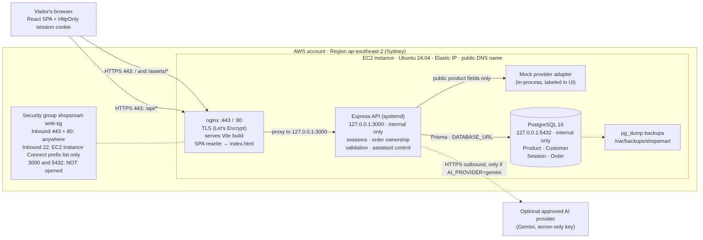

# ShopSmart AWS Deployment Plan and Decision Record

**Course:** PDC50 Full Stack AI Application Development · BSIT-4A
**Developer:** Reighfer Joshua V. Bondoc (solo)
**Guide followed:** *ShopSmart AWS Deployment Learning Guide* (13 November 2026)
**Release:** ShopSmart v1.1.0
**Plan date:** 20 November 2026

> Filled in after the hosted deployment on 20 November 2026. Open owner actions: enable root MFA (§4) and clean up after grading (§11).

---

## 1. What the deployed application must do

| Requirement from the guide | How v1.1.0 meets it | Where |
|---|---|---|
| A visitor opens ShopSmart and sees current products | `GET /api/products` reads PostgreSQL on every request | `backend/src/routes/products.js` |
| A visitor uses the cart | Cart state + `localStorage` persistence | `frontend/src/context/CartContext.jsx` |
| A visitor asks the assistant a supported product question | Server selects eligible records, verifies the draft, labels the provider | `backend/src/services/assistant.js` |
| A fictional test customer signs in | Register/login with scrypt-hashed passwords and an HttpOnly session cookie | `backend/src/routes/auth.js`, `frontend/src/pages/AccountPage.jsx` |
| The customer completes a simulated order | `POST /api/orders` requires sign-in, saves the order with `customerId` | `backend/src/routes/orders.js` |
| The API enforces access to private order records | `GET /api/orders/:id` returns 401 to guests and 404 to any customer who is not the owner | `backend/src/lib/auth.js` (`canReadOrder`) |
| Success is judged on the hosted addresses, not on a green build | `npm run smoke -- <url>` runs the customer journey against the real URL and writes evidence | `scripts/smoke-test.mjs` |

---

## 2. Decision record: architecture

**Decision:** Layout A, **single EC2 host** (nginx + Express + PostgreSQL on one Ubuntu 24.04 instance) in **ap-southeast-2 (Sydney)**.

**Status:** Accepted for the classroom demonstration. Layout B is documented and supported by the code as the alternative.

### Context
- The demo is short, uses only fictional data and simulated checkout.
- Sign-in sends a password, so the API **must** be reachable over HTTPS before any sign-in flow is published.
- The account runs on Free plan credits that are finite and expire, so fewer always-on resources is better.
- I am already comfortable with EC2, SSH and Linux service management.

### Options considered

| | Layout A: single EC2 host (chosen) | Layout B: Amplify + EC2 + RDS |
|---|---|---|
| Services to configure | EC2, security group, Elastic IP | Amplify, EC2, security groups ×2, RDS, subnet group, Elastic IP or load balancer |
| HTTPS for the API | One certificate on nginx covers both frontend and API | Amplify gives the frontend HTTPS, but the EC2 API still needs its **own** HTTPS endpoint or the browser blocks it as mixed content |
| Cookies and CORS | Same origin (`https://<domain>/` and `https://<domain>/api`), so no CORS and `SameSite=Lax` cookies | Cross-site: needs CORS with credentials and `SameSite=None; Secure` cookies |
| Database | PostgreSQL on the instance, bound to localhost | Managed RDS in private subnets, reachable only from the API security group |
| What the team must own | OS patches, process, DB, backups, HTTPS renewal, cleanup. **Single point of failure.** | Fewer OS duties for the DB, but more connections and more resources consuming credits |
| Credit use | 1 instance + volume + public IPv4 | Instance + RDS instance + RDS storage + Amplify build minutes + public IPv4 |

### Why A
1. One HTTPS certificate solves the mixed-content and secure-cookie problem for both the site and the API.
2. Same-origin requests remove the whole class of CORS and cross-site cookie failures.
3. Fewest resources to consume credits and fewest to forget at cleanup.
4. Every responsibility is visible on one machine, which makes it easy to explain in the demo.

### Consequences we accept
- If the instance stops, the site, API and database all stop. Acceptable for a supervised demo.
- We run the backups ourselves (`shopsmart-backup` before every release). Deleting the instance or its volume deletes the data, so I copy the newest dump off the host before cleanup if it must be kept.
- We must renew the certificate. certbot's timer handles it, and the demo is shorter than the 90-day certificate life.

### How the code supports Layout B if the instructor requires it
- `amplify.yml` builds the `frontend` workspace from the monorepo root and documents the SPA rewrite rule.
- Backend settings: `FRONTEND_URL=https://<amplify-domain>`, `COOKIE_SAMESITE=none`, `COOKIE_SECURE=true`. CORS already allows credentials for listed origins only.
- RDS: private, no public access, inbound 5432 only from the API security group. `DATABASE_URL` points to the RDS endpoint.

### Fallback (allowed by the guide)
If an eligible account, approved hosting or a safe HTTPS design is unavailable, I present the **tested local release** and this AWS architecture, and state what must change before going online. I do **not** publish a sign-in form over plain HTTP.

---

## 3. Deployment diagram



Source: `docs/diagrams/aws-deployment.mmd` (Mermaid).

### Trace of one request
1. Browser → `https://<domain>/` → nginx serves `index.html` and the hashed `/assets/*.js`.
2. React calls `GET https://<domain>/api/products` (same origin, cookie sent automatically).
3. nginx proxies `/api/` to `127.0.0.1:3000`. Express validates the request and loads the session.
4. Prisma reads PostgreSQL at `127.0.0.1:5432`, Express returns JSON, React renders the products.
5. For an assistant question, Express first selects active, in-stock, relevant products, sends **only their public fields** to the provider adapter, then verifies product IDs and prices in the draft against those records before replying.

If any hop fails (DNS, certificate, nginx, the Node process, the database), the page can load but show no products. Section 9 maps each symptom to the hop to inspect.

---

## 4. The AWS account before using it

The guide states that newer accounts on the **Free plan** get US$100 in credits at sign-up and can earn up to US$100 more. The plan lasts at most six months or until credits run out, limits available services, and closes when it ends unless upgraded. A Paid-plan or older account may incur charges. A "free tier eligible" label is **not** a promise that every attached resource or transfer is free.

### Decisions to record

| Decision | Why it matters | Evidence | Value |
|---|---|---|---|
| Free or Paid plan; credit balance; credit expiry | Decides whether the demo can run without a bill and when it must end | Redacted screenshot of Billing and Cost Management → plan and credits page | plan: **Free plan** ("Your free plan account does not get charged") · credits left: **US$110.23** on 20 Nov 2026 before launch · **171 days remaining on 20 Nov 2026 (plan ends about 10 May 2027)** · evidence `docs/evidence/account-free-plan-credits.jpg` |
| Region | Resources in other Regions are easy to miss during cleanup | Resource register (section 5) | ap-southeast-2 (Sydney) for every resource |
| Expected duration | An always-running instance and volume consume credits even with no visitors | Demo dates and removal plan | created **20 Nov 2026** · demo: class presentation · removal by: **end of grading** (see §11) |
| Budget alert | Early warning before credits are exhausted | Screenshot of the budget (no account numbers) | zero-spend budget `shopsmart-zero-spend` (US$0.01/month, email alert at 100%) created: **yes** · `docs/evidence/account-budgets.jpg` |

### Access ownership
- Root user: root credentials never shared. **Finding on 20 Nov 2026: `aws iam get-account-summary` reports `AccountMFAEnabled: 0`, so root MFA is not yet enabled.** Action for the owner: enable an MFA device for the root user (IAM → Security credentials) and add a redacted screenshot.
- Daily work identity: the account has **no IAM users**; console and CloudShell work ran as the role session `AccountFullAccessRole` (from `aws sts get-caller-identity`). That role has full access, which is broader than this task needs. A least-privilege IAM identity (EC2 in ap-southeast-2 + Billing read) is the recommended improvement before any longer-lived use.
- **AWS identity ≠ ShopSmart identity.** IAM decides who may manage AWS resources. ShopSmart's own sign-in identifies a *customer*, and Express decides whether that customer may read an order. Giving someone AWS access does not let them read another customer's order, and the ownership check in the API is what enforces that.

---

## 5. Resource register

Keep this table current while building. No credentials, account IDs or passwords.

| # | Service | Resource / name | Region | Owner | Purpose | Created | Planned removal | Cost note |
|---|---|---|---|---|---|---|---|---|
| 1 | EC2 instance | `shopsmart-demo` i-034dd01c285ae5170 (t3.micro, Ubuntu 24.04, no key pair) | ap-southeast-2 | R. J. Bondoc | nginx + Express + PostgreSQL | 2026-11-20 | after grading | Charged per running hour; **stop** it between sessions |
| 2 | EBS volume | root volume of #1 (gp3, 20 GiB) | ap-southeast-2 | R. J. Bondoc | OS, app, database files, backups | 2026-11-20 | with #1 (DeleteOnTermination=true) | Charged while it exists, **even when the instance is stopped** |
| 3 | Elastic IP | `shopsmart-eip` 13.210.209.254 | ap-southeast-2 | R. J. Bondoc | Stable address for DNS and the certificate | 2026-11-20 | release after #1 | Public IPv4 addresses are billed hourly; an unattached one still costs |
| 4 | Security group | `shopsmart-web-sg` sg-04a2df633d4542b97 | ap-southeast-2 | R. J. Bondoc | 443/80 from anywhere; 22 only from the EC2 Instance Connect prefix list | 2026-11-20 | with #1 | none |
| 5 | Key pair | not created: EC2 Instance Connect pushes a 60-second key per session | ap-southeast-2 | R. J. Bondoc | Administration | n/a | n/a | none |
| 6 | AWS Budgets | `shopsmart-zero-spend` | global | R. J. Bondoc | Alert before credits run out | 2026-11-20 | after cleanup | none |
| 7 | DNS name | `shopsmart-13-210-209-254.sslip.io` | n/a | R. J. Bondoc | Hostname for the TLS certificate | 2026-11-20 | n/a | none |

Check every Region in the console before closing the demo (EC2 → Global view).

**Not part of ShopSmart:** the same Region also holds the SAM10 AutoHub instance (t3.small), its Elastic IP and security group `autohub-web`, and the `autohub-monthly` budget. Do **not** delete those during ShopSmart cleanup; only resources tagged `Project=ShopSmart` belong to this demo.

**How it was launched:** from AWS CloudShell with the AWS CLI. The instance's user data waits until the Elastic IP is attached, clones the repository and runs `deploy/setup-ec2.sh shopsmart-13-210-209-254.sslip.io <owner-email> v1.1.0`. Setup finished with `USERDATA_EXIT=0`.

---

## 6. Network and ports

| Port | Exposed to | Why |
|---|---|---|
| 443 (HTTPS) | Internet | The only entry point for the site and the API |
| 80 (HTTP) | Internet | Redirects to 443 and answers Let's Encrypt renewals. Serves no app content |
| 22 (SSH) | **EC2 Instance Connect prefix list only** (`com.amazonaws.ap-southeast-2.ec2-instance-connect`). During verification a temporary /32 rule for CloudShell was added and then revoked. | Administration |
| 3000 (Express) | **Nobody.** Bound to `127.0.0.1`, not in the security group | Internal hop behind nginx |
| 5432 (PostgreSQL) | **Nobody.** Ubuntu default listens on localhost, not in the security group | The browser must never connect to the database |

Two layers protect the internal ports: the security group does not allow them, **and** the processes bind to localhost (`HOST=127.0.0.1`). The smoke test probes 3000 and 5432 from outside and expects both to be closed.

**HTTPS hostname.** Let's Encrypt needs a DNS name, not a bare IP. For a domain-less classroom demo I use the free wildcard DNS `sslip.io`: Elastic IP `13.250.10.20` becomes `shopsmart-13-250-10-20.sslip.io`. If certificate issuance fails there, I use a domain I control, or fall back to the local release (section 2).

---

## 7. Frontend hosting and public configuration

- React source is for development; `npm run build` produces `frontend/dist`, which nginx serves from `/var/www/shopsmart`.
- **A green build proves only that files were prepared, not that products load.** The smoke test proves the latter.
- **SPA rewrite:** `try_files $uri $uri/ /index.html` lets a direct visit or refresh of `/account` or `/orders/12` load the app. Verified by smoke rows "Direct visit …".
- **Public API setting:** `VITE_API_URL=/api` at build time (same origin). Vite copies `VITE_*` values into browser code, so it holds only a public URL, never a database password or AI key. If the public URL changes, the frontend must be **rebuilt** (`shopsmart-deploy` always rebuilds).

| Variable | Where | Value class |
|---|---|---|
| `VITE_API_URL` | Build of frontend | Public URL (`/api`, or `https://api.<domain>/api` in Layout B) |
| `DATABASE_URL` | `/etc/shopsmart/api.env` (640, root:shopsmart) | **Secret**, server-only |
| `GEMINI_API_KEY` (only if approved) | `/etc/shopsmart/api.env` | **Secret**, server-only |
| `FRONTEND_URL`, `TRUST_PROXY`, `REQUIRE_HTTPS`, `COOKIE_*`, `AI_PROVIDER` | `/etc/shopsmart/api.env` | Non-secret server config |
| `APP_VERSION`, `GIT_COMMIT` | `/etc/shopsmart/release.env` (written by deploy) | Non-secret, shown in `/api/health` |

**Mixed content and passwords.** An HTTPS page calling an HTTP API is blocked by the browser. In addition, with `REQUIRE_HTTPS=true` the API refuses `/api/auth/register` and `/api/auth/login` unless the request arrived over HTTPS (`HTTPS_REQUIRED`), so no password can be sent over plain HTTP, even by mistake.

---

## 8. API host, database, and assistant

### Process and restarts
EC2 does not start Express by itself after a reboot. `deploy/systemd/shopsmart-api.service` runs `node src/server.js` as the unprivileged `shopsmart` user, restarts it on failure, starts it at boot after PostgreSQL, and sends logs to journald (`sudo journalctl -u shopsmart-api -f`).

### Health checks
- `GET /api/health/live`: the Node process answers.
- `GET /api/health`: also runs `SELECT 1` and reads the `Customer` table, so it fails with **503 `database: "unreachable"`** if PostgreSQL is down or the latest migration was not applied. It also reports `version`, `commit` and `assistantProvider`.
- Even this does not prove checkout works, which is why the smoke test places a real simulated order.

### Database persistence and migrations
- PostgreSQL stores data independently of the browser and of the API process; products and orders survive an API restart (verified by the restart check).
- `DATABASE_URL` is server-only: never committed, never in a screenshot, never a `VITE_` variable.

| Migration | What it does | Data effect |
|---|---|---|
| `20260910103102_initial_schema` | Product, Order, OrderItem | Creates tables |
| `20261120090000_add_customer_accounts` | Customer, Session, nullable `Order.customerId` + FK `ON DELETE SET NULL` | **Additive only.** Existing orders kept, with no owner |

**Data-preservation decision.** `Order.customerId` is nullable so orders created before accounts existed are not deleted or rewritten. They have no owner, so `canReadOrder` lets **no** customer read them through the API. Tested by applying both migrations to PostgreSQL 16 with a pre-existing order (row kept, `customerId` NULL).

**Development vs release (Prisma 6):**
- `npm run db:migrate` → `prisma migrate dev`: creates and applies migrations locally only.
- `npm run db:deploy` → `prisma migrate deploy`: applies already committed migrations. This is the **only** migration command used on the server.
- `npm run db:seed` is **destructive** (deletes all orders, customers and products). It now refuses to run with `NODE_ENV=production`. The server uses `npm run db:seed:catalog`, which only adds missing starter products and never touches orders or customers.
- `shopsmart-deploy` takes a `pg_dump` backup **before** migrating.

### Assistant trust boundary
1. Express selects active, relevant, in-stock products (top 3) **before** any provider is involved. No match → honest answer, provider never called.
2. Only `id, name, category, description, price, stock` of those products are sent. Never customer names, addresses, orders, passwords or account records.
3. Product descriptions are wrapped as `CATALOG_DATA` and marked as untrusted data, so a description saying "ignore your rules" stays catalog text.
4. The draft is checked: unknown product IDs are dropped (all unknown → verified fallback), and any ₱ amount that does not match a recommended product's current price replaces the wording with the verified catalog sentence.
5. Timeout (8 s), HTTP 429, malformed JSON and provider errors each end in a labeled, verified fallback with a notice.
6. The provider key, if any, lives only in `api.env` and is sent in a header (not the URL).

**Provider for this deployment: `AI_PROVIDER=mock`.** A paid provider is not required. Every answer shows a badge, *"Simulated provider (mock adapter) — no live AI call is made"*, so the instructor can tell a simulated provider failure from a live call. `MOCK_PROVIDER_BEHAVIOR` (`timeout`, `rate_limit`, `malformed`, `hallucinate`, `wrong_price`) rehearses each failure path on the hosted app. Switching to Gemini needs instructor approval, `AI_PROVIDER=gemini` and a key in `api.env`. Check the current model name first, because older model IDs are retired over time.

---

## 9. Implementation the team chose (runbook)

This is our own implementation of the targets above, not a copy of console clicks.

1. **Account checks (done 20 Nov; root MFA still to be enabled by the owner):** plan, credits, expiry, root MFA, IAM identity, zero-spend budget. Region: ap-southeast-2 (Sydney). The Free plan limits this account to Sydney, so Singapore was not available.
2. **Launch:** Ubuntu Server 24.04 LTS, t3.micro (or t3.small), 20 GiB gp3, key pair `shopsmart-key`, security group per section 6. Tag every resource `Project=ShopSmart`, `Owner=RJBondoc`.
3. **Elastic IP:** allocate and associate. Hostname: `shopsmart-<a-b-c-d>.sslip.io`.
4. **Setup:** `ssh ubuntu@<eip>` →
   ```bash
   git clone https://github.com/reighbabs27/PDC50_ShopSmart.git ~/PDC50_ShopSmart
   sudo bash ~/PDC50_ShopSmart/deploy/setup-ec2.sh shopsmart-<a-b-c-d>.sslip.io <my-email> v1.1.0
   ```
   Read the script before running it. It adds swap, installs nginx, PostgreSQL, Node 22 and certbot, creates the `shopsmart` user and database with a generated password in `/etc/shopsmart/api.env`, gets the certificate, installs the systemd unit, then runs the first release.
5. **Later releases:** commit, tag, then `sudo shopsmart-deploy v1.1.x` (backup → checkout → `npm ci` → `prisma migrate deploy` → build → publish → restart → health).
6. **Verify from my laptop:** `npm run smoke -- https://shopsmart-<a-b-c-d>.sslip.io`, then the manual checks in `docs/AWS_VERIFICATION_RECORD.md`.

---

## 10. Symptom → where to investigate

| What you see | Look here first |
|---|---|
| Home page blank or build fails | `shopsmart-deploy` output (build step), `/var/www/shopsmart/index.html` exists, missing import, `VITE_API_URL` at build time |
| Home works, refresh of `/account` gives 404 | nginx `location /` must have `try_files … /index.html` |
| Page loads, no products | Browser Network tab: request URL and status → mixed content / CORS → `sudo journalctl -u shopsmart-api` → `curl -s localhost:3000/api/health` (`database`) |
| Health works, checkout fails | Response `error.code` (422 validation, 409 stock, 401 session) → API log by `traceId` → `npm run db:status` → product stock |
| Login seems to work, protected requests fail | Set-Cookie has `Secure` but site on HTTP? `TRUST_PROXY=true` and nginx `X-Forwarded-Proto`? Cookie sent (`credentials: 'include'`)? Session expired? |
| Assistant spins or cites an unknown product | Response `provider.status` / `provider.reason`; 20 s client timeout; API log `[assistant] provider … failed: <kind>` |
| `HTTPS_REQUIRED` on sign-in | The request reached Express over HTTP: check the nginx redirect and `TRUST_PROXY=true` |

Record the old and new value for every setting you change, and change one thing at a time. A green AWS status or a green build answers a narrower question than the customer journey.

---

## 11. End of the demo: cleanup plan

1. `sudo shopsmart-backup` and `scp` the newest dump to my laptop **only if** the data must be kept (fictional data, so normally not).
2. Terminate the EC2 instance and confirm the root volume is deleted (EC2 → Volumes).
3. **Release the Elastic IP** (an unattached public IPv4 is still billed).
4. Delete the security group and key pair.
5. EC2 Global view: no ShopSmart resources in any Region.
6. Screenshot Billing: credits remaining after cleanup. ☐ after cleanup
7. Update the resource register with actual removal dates.
