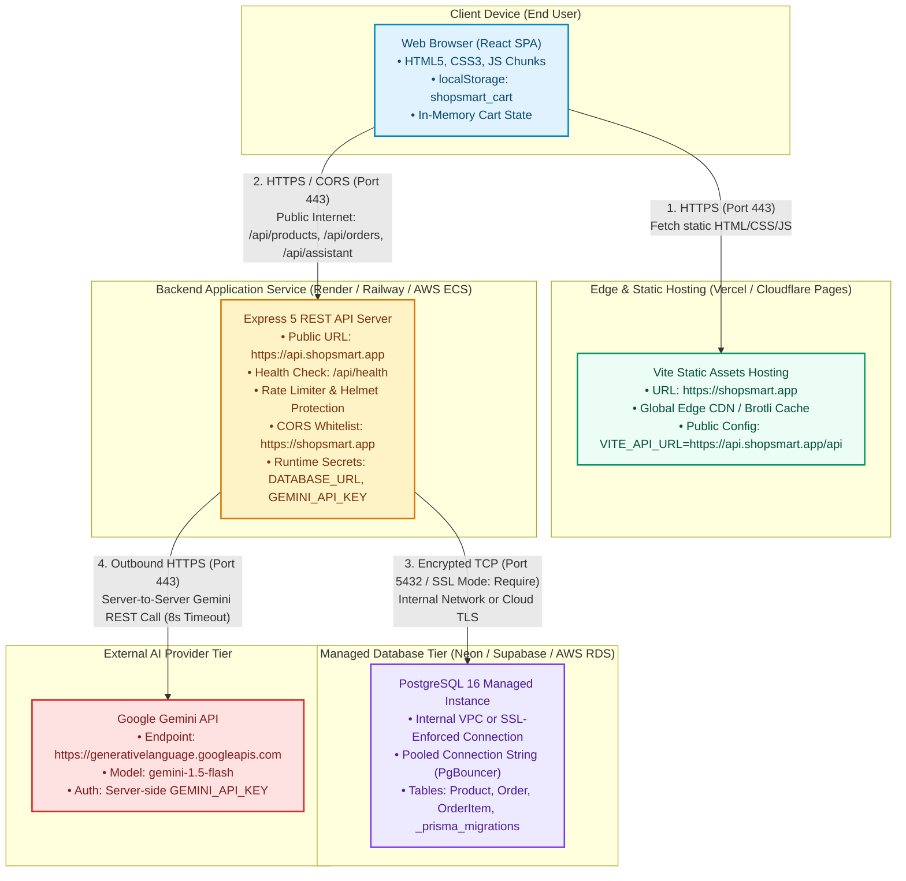

# ShopSmart Cloud Deployment Plan & Architecture Specification

**Course & Section:** PDC50 / BSIT-4A  
**Module:** Activity 4 — Deployment Architecture & Environment Configuration  
**Activity Mode:** Individual / Solo Laboratory Activity  
**Student / Developer:** Reighfer Joshua V. Bondoc  
**Date:** November 15, 2026  

---

## 1. System Architecture Diagram



---

## 2. Answers to the 7 Core Deployment Questions

### Question 1: Where will the Vite build files be hosted? Which URL will the frontend use for the API?
* **Hosting Platform:** The compiled production build (`frontend/dist`) will be deployed to a modern global Edge CDN static platform, such as **Vercel**, **Cloudflare Pages**, or **Netlify**.
* **Frontend Public URL:** `https://shopsmart-client.vercel.app` (or custom domain `https://shopsmart.app`).
* **API Target URL:** The frontend receives the API URL via the build-time public variable:
  ```env
  VITE_API_URL="https://api.shopsmart.app/api"
  ```
  Because Vite embeds variables prefixed with `VITE_` into client JavaScript bundles, `VITE_API_URL` is purely public configuration pointing to the Express API base route.

### Question 2: Where will the Express server run, and what public URL will serve `/api/health`?
* **Hosting Platform:** The Express server runs as a containerized Node.js service on a platform such as **Railway**, **Render**, or **Fly.io**, configured with automatic restarts and zero-downtime health rollouts.
* **Public Base URL:** `https://api.shopsmart.app`
* **Health Endpoint:** The public health endpoint is:
  ```
  GET https://api.shopsmart.app/api/health
  ```
  Returning `200 OK` with JSON `{"status": "ok"}`. This endpoint is probed by the host's load balancer to monitor service vitality.

### Question 3: Where will PostgreSQL run, and how will the server receive `DATABASE_URL` securely?
* **Hosting Platform:** PostgreSQL runs on a managed cloud database provider with automated daily backups and point-in-time recovery (e.g., **Neon Serverless Postgres**, **Supabase**, or **AWS RDS PostgreSQL**).
* **Secure Secret Injection:**
  * The connection string (`DATABASE_URL`) is never hard-coded, committed to Git, or exposed in client bundles.
  * It is injected directly into the Express container's runtime environment via the hosting platform's encrypted secrets dashboard:
    ```
    DATABASE_URL="postgresql://shopsmart_app:<SECURE_PASSWORD>@ep-rapid-pool.us-east-1.aws.neon.tech/shopsmart?sslmode=require&pgbouncer=true"
    ```
  * At runtime, Node reads `process.env.DATABASE_URL`, and Prisma establishes an SSL-encrypted TLS connection.

### Question 4: Which origin will be permitted by `FRONTEND_URL` and the API CORS configuration?
* **Configured Origin:** Only the exact HTTPS origin of the deployed frontend will be allowed:
  ```env
  FRONTEND_URL="https://shopsmart-client.vercel.app"
  ```
* **Enforcement:** In `backend/src/app.js`:
  ```javascript
  app.use(cors({
    origin: process.env.FRONTEND_URL || 'http://localhost:5173',
    methods: ['GET', 'POST'],
    allowedHeaders: ['Content-Type', 'Authorization']
  }));
  ```
  Any unauthorized cross-origin request from an untrusted web page is rejected at the HTTP preflight stage.

### Question 5: Where will a provider key be stored, if present? How will it be kept out of the frontend bundle and repository?
* **Storage Location:** `GEMINI_API_KEY` is stored strictly as a server-side environment secret in the backend cloud platform's encrypted variables vault.
* **Isolation Mechanisms:**
  1. **Git Isolation:** `.gitignore` explicitly ignores `.env` and `.env.*` files, preventing accidental commits to source control.
  2. **Bundle Exclusion:** Vite only bundles environment variables prefixed with `VITE_`. Because the secret is named `GEMINI_API_KEY` (without `VITE_`), the bundler never exposes it to client-side scripts.
  3. **Runtime Proxy:** The frontend never contacts the Gemini API directly. It posts questions to `/api/assistant/questions`. The Express backend loads catalog facts, enforces rate limits, queries the Gemini API server-to-server, and verifies all candidates before responding.

### Question 6: How will database migrations be applied before first use, without wiping existing orders?
* **Production Command:** Migrations must be executed using the Prisma production command:
  ```bash
  npx prisma migrate deploy
  ```
* **Why NOT `prisma migrate dev` or `db:seed`:**
  * `prisma migrate dev` is designed for local development and will prompt to reset (drop) the database if any schema deviation or historical mismatch is detected.
  * `prisma migrate deploy` executes only unapplied SQL migrations idempotently without resetting tables, preserving existing `Order`, `OrderItem`, and `Product` records.
  * `npm run db:seed` executes `deleteMany()` across all orders and products before inserting sample data. In production/staging, seeding is skipped or scoped strictly to missing baseline products without touching transactional tables.
* **CI/CD Deployment Pipeline Hook:**
  In the container startup script or Railway build/release phase:
  ```bash
  npm run build --workspace backend && npx prisma migrate deploy --schema=backend/prisma/schema.prisma && npm start --workspace backend
  ```

### Question 7: Who can access the staging app, and will only fictional customer data be used?
* **Access Control:**
  * Staging is restricted to the instructor, evaluators, and developer via HTTP Basic Authentication, VPN, or IP allowlisting configured at the reverse proxy level.
* **Privacy & Safeguards:**
  * Only fictional customer names (e.g. *Juan Dela Cruz*, *Maria Santos*, *Liza Soberano*), dummy emails (`@example.ph`, `@example.com`), and public simulated delivery addresses are permitted.
  * The simulated checkout explicitly avoids requesting payment cards, bank account details, or government identification numbers.
  * A persistent banner is rendered on all pages: *"ShopSmart classroom starter • Simulated purchases only"*.
